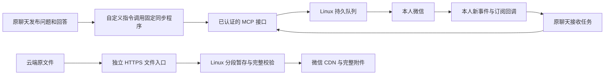

# WeChat MCP Bridge

将本人微信单聊接入支持 MCP 的 AI 客户端。客户端通过自定义指令转发新问答，微信来信通过事件订阅交给同一个助手，Linux 主机负责微信收发、持久队列和文件交付。

## 0.3.0 更新

- **聊天主动同步**。原聊天发布回答后，直接调用 MCP，把本轮问题和回答按顺序交给持久队列。
- **持久执行配置**。固定同步程序保存在聊天自定义指令中，运行缓存丢失后可恢复程序及最新本人事件索引。
- **云端大文件直传**。云端通过 HTTPS 向 Linux 上传原始二进制，每段最多 90,000,000 字节，支持段内续传、完整重组和 SHA-256 校验，再以完整附件发送微信。
- **减少重复调用**。来源观察、完整历史核查、首次预占合并处理，独立读取并行，验证公钥在后台刷新。
- **阶段计时**。分开记录工具等待、服务端处理、入队与实际微信发送，便于定位延迟。

[第二次更新说明](docs/更新说明20261115.md) · [Dot 自定义指令与固定程序](examples/Dot自定义指令.md)

## 工作流



文字和文件的数据路径可由云端与 Linux 完成。Windows 用于开发和管理。聊天客户端需要具备原消息读取、工具调用及事件订阅能力，具体工具名和任务身份在配置时填写。

## 环境与安装

Linux、Node.js 24 以上、npm、`flock`、`qrencode`、系统 `/usr/bin/python3` 和 Pillow。示例按 Debian/Ubuntu 编写。

```sh
sudo apt install python3-pil python3-venv qrencode util-linux
cd wechat-core-offline
npm ci --ignore-scripts
cd ../large-media
npm ci --ignore-scripts
```

状态文件使用当前 Linux 用户的私有目录。将 `.env.example` 复制到仓库外，填写本人身份、HTTPS 域名、Access issuer 和 audience。

```sh
mkdir -p "$HOME/.local/state/wechat-mcp" "$HOME/.config/wechat-mcp"
chmod 700 "$HOME/.local/state/wechat-mcp" "$HOME/.config/wechat-mcp"
cp .env.example "$HOME/.config/wechat-mcp/bridge.env"
chmod 600 "$HOME/.config/wechat-mcp/bridge.env"
# 在本地编辑配置后加载自己维护的配置文件。
set -a
. "$HOME/.config/wechat-mcp/bridge.env"
set +a
```

`BRIDGE_STATE_DIR` 填绝对路径。`BRIDGE_OWNER_EMAIL` 与 Access 登录邮箱一致。`BRIDGE_ACCESS_ISSUER` 填 HTTPS origin，`BRIDGE_ACCESS_AUDIENCE` 填该 Access 应用的 audience。`BRIDGE_PUBLIC_HOST` 填 MCP 对外域名。

## 微信绑定与长期运行

服务停止时，在本人的交互 SSH 终端运行登录入口，扫码并发送终端显示的验证文字。

```sh
node wechat-live-stage/wechat-login-cli.mjs
node wechat-core-offline/main-live.mjs
```

HTTPS 入口通过 Cloudflare Access 认证后转发至 `127.0.0.1:4181/mcp`。桥接器验证 JWT 签名、issuer、audience、本人邮箱和期限。可使用 [systemd 用户服务示例](examples/wechat-mcp.service) 与 [文件接收服务示例](examples/wechat-large-media.service)。修改工作目录与配置路径后安装到 `~/.config/systemd/user/`，运行 `systemctl --user daemon-reload` 与 `systemctl --user enable --now wechat-mcp.service`。需要关掉 SSH 后持续运行时，可由管理员启用该用户的 linger。

每次进程重启后，出站同步队列进入暂停状态。通过 `get_chatgpt_sync_delivery_status` 核对当前 epoch、队列和既有结果，确认没有待处理、失败、未知或发送中记录后，由本人调用 `resume_empty_chatgpt_sync` 完成本次恢复。工具要求的确认对应实际队列审查。微信入站轮询与出站队列分别处理。

## 接入原聊天

1. 添加已认证的 MCP 连接，确认文字、媒体和大文件工具可见。
2. 为原聊天创建接收任务，订阅 `weixin.owner_text` 与 `weixin.owner_media`。接收任务处理微信来信，原聊天自定义指令处理客户端新问答。
3. 在配置中填入自己的聊天 ID、连接 ID、作者 ID 和真实任务版本，然后按 [自定义指令示例](examples/Dot自定义指令.md) 保存固定程序。
4. 分别验证客户端新问答、微信新来信和文件附件，核对真实发送结果。

`send_wechat_reply` 的首次发送使用原事件和稳定幂等键。已发起后结果无法取得时，再以原键查询状态。近期记录中没有匹配项的 `unknown` 只描述查询覆盖范围，首次来信处理以实际执行记录判断。

## 云端文件直传

启用 `XDW_LARGE_MEDIA=1`，填写相同的 `BRIDGE_ROOM_ID`、文件暂存目录与两个本机套接字路径。接收服务按命令行参数取得数据目录和运行目录，桥与接收服务须使用同一个 Linux 用户。

```sh
node large-media/large-media-daemon.mjs "$BRIDGE_LARGE_MEDIA_ROOT" "${BRIDGE_LARGE_MEDIA_SOCKET%/control.sock}"
```

配置独立 HTTPS 域名，将请求转发至 `127.0.0.1:4183`，并填入 `BRIDGE_FILE_UPLOAD_ORIGIN`。该入口使用 MCP 创建的单次上传 Bearer 凭证，代理应保留 Authorization、原始二进制请求体和上传保活响应。每段允许 90,000,000 字节，代理单请求容量应覆盖这一大小，并配置适合长上传的超时。

调用顺序如下。

1. `begin_large_wechat_file_upload` 绑定有效本人事件、真实附件来源、文件名、大小及完整 SHA-256。
2. 按返回的协议上传原始字节。`large-media/large-media-client.mjs` 提供支持段内续传的客户端函数 `uploadLargeMedia`。云端需能读取原文件并执行 HTTPS 上传。
3. `/finish` 完成重组和总摘要核对。
4. `send_large_wechat_file_upload` 调用原微信桥上传完整文件并发送附件，`get_large_wechat_file_status` 查询原结果。

已实测 100,002,422 字节 PDF，以 90,000,000 与 10,002,422 字节两段上传，完整摘要一致，并以单个完整 PDF 首次发送成功。暂存按磁盘空间、并发和上传期限管理。

旧媒体接口仍处理最多 20 MiB 的入站图片/文件及兼容发送，每块最多 128 KiB。静态 PNG、JPEG、WebP 会实际解码校验。这些参数属于旧媒体接口，大文件直传采用独立二进制入口。

## 测试与延迟

纯本机隔离测试使用合成数据，覆盖鉴权、队列、去重、并发恢复、来源账本、百兆 PDF 重组和客户端编排。完整测试需要 PyMuPDF 解析重组后的 PDF。

```sh
python3 -m venv /tmp/wechat-mcp-tests
/tmp/wechat-mcp-tests/bin/pip install Pillow PyMuPDF
export PATH=/tmp/wechat-mcp-tests/bin:$PATH
cd wechat-core-offline
npm test
```

实测连续问答样本整轮 20.82 秒，其中回答发布约 4.37 秒，发布后同步约 16.45 秒。两次入队调用分别约 4.77 秒和 2.68 秒，对应服务端处理约 36 和 37 毫秒。无缓存恢复样本整轮 48.90 秒。主要优化方向为同步启动、模型准备及工具往返，完整数据与最新修复见更新说明。

## 目录与许可证

- `wechat-core-offline/` 提供认证 MCP、来源账本、媒体工具及诊断。
- `wechat-live-stage/` 提供微信登录、收发与运行控制。
- `large-media/` 提供独立二进制接收、重组、续传及微信大文件发送。
- `examples/` 提供通用聊天编排、指令和 systemd 示例。
- `video/20261115/` 保存本次视频旁白、渲染程序与字幕源码。

运行状态、密钥、二维码、实际对话与上传凭证保存在仓库外。原创部分采用 MIT 许可证，依赖说明见 [第三方声明](THIRD_PARTY_NOTICES.md) 与 [安全说明](SECURITY.md)。
